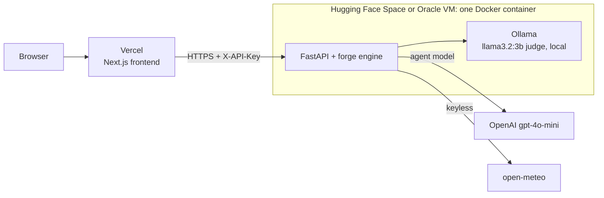

# Deploying ForgeAI for free

**Frontend → Vercel (free). Backend → Hugging Face Spaces (Docker, free CPU Basic).** If Hugging Face refuses the
free tier for your account, use the **Oracle Cloud Always Free VM** instead (section 4). The same Docker image works
on both.



## Why these platforms

| Platform | Free tier (checked Nov 2026) | Verdict |
|---|---|---|
| Hugging Face Spaces, Docker | 2 vCPU, 16 GB RAM, 50 GB disk; sleeps after 48 h without visitors | Best fit, room for the local Ollama judge. Some new accounts report a "cpu-basic quota" error since mid-2026: if you get it, use Oracle. |
| Oracle Cloud Always Free | Arm VM, reported 2 OCPU / 12 GB since June 2026; card needed for verification | Works, you manage the server |
| Google Cloud Run | free monthly allowance, scales to zero, billing card needed | Works without the local judge (falls back to the hosted model) |
| Render / Koyeb free | 512 MB RAM, 0.1 CPU | Too small: embeddings + OCR + tables do not fit. `render.yaml` is kept for a paid 2 GB plan. |
| Vercel Hobby | free | Frontend |

## 0. Before going public: protect your API credit

Anyone who finds the URL could start builds on your OpenAI key. So:
1. Make a **new** OpenAI key for the deployment (platform.openai.com/api-keys) and set a monthly limit on it.
2. Pick a long random `API_KEY` (any password generator). The backend rejects calls without it; the frontend sends it.
3. The image already caps every run at 450 calls / 500k tokens / 1 hour and runs one build at a time.

## 1. Backend on Hugging Face Spaces (about 15 minutes, mostly build time)

1. Sign in at huggingface.co → **New Space**.
2. Name `forgeai`, **SDK: Docker** (Blank template), **Hardware: CPU basic (free)**, visibility **Public**
   (a private Space cannot be called from the Vercel site).
3. In the Space: **Files → Add file → Upload files**. Upload the two files from this repo's
   `deploy/huggingface/` folder: `README.md` and `Dockerfile`. Commit.
4. **Settings → Variables and secrets**:
   - Secret `OPENAI_API_KEY` = your deployment key
   - Secret `API_KEY` = your random password from step 0
   - Variable `CORS_ORIGINS` = `http://localhost:3000` for now (you add the Vercel URL in section 3)
5. Wait for the build (first build ~10 to 15 min: it installs Ollama and downloads the 2 GB judge model).
   The Space shows **Running** when done.
6. Check `https://<your-username>-forgeai.hf.space/health` → `{"status":"ok"}`, and
   `https://<your-username>-forgeai.hf.space/docs` for the API.

The Space builds from the public GitHub repo. After you push new code to GitHub, open the Space
**Settings → Factory rebuild**.

## 2. Frontend on Vercel (about 5 minutes)

1. Sign in at vercel.com with GitHub → **Add New → Project** → import `AyushSingh2024/ForgeAI`.
2. **Root Directory: `frontend`** (framework is detected as Next.js).
3. **Environment Variables**:
   - `NEXT_PUBLIC_API_URL` = `https://<your-username>-forgeai.hf.space`
   - `NEXT_PUBLIC_API_KEY` = the same `API_KEY` as the Space
4. **Deploy**. You get `https://<project>.vercel.app`.

## 3. Connect them

In the Space **Settings → Variables**, set `CORS_ORIGINS` to
`https://<project>.vercel.app,http://localhost:3000` and restart the Space. Open the Vercel URL: the status pill
should turn green (the first request after a sleep can take a minute).

## 4. Alternative backend: Oracle Cloud Always Free VM

1. Create an **Always Free** Ampere (Arm) instance, Ubuntu 22.04 or 24.04. In its VCN security list, open TCP 80 and 443.
2. On the VM:
   ```bash
   sudo apt-get update && sudo apt-get install -y docker.io git
   git clone https://github.com/AyushSingh2024/ForgeAI.git && cd ForgeAI
   sudo docker build -t forgeai .
   sudo docker run -d --restart unless-stopped -p 127.0.0.1:7860:7860 \
     -e OPENAI_API_KEY=... -e API_KEY=... -e CORS_ORIGINS=https://<project>.vercel.app forgeai
   ```
3. HTTPS is required (the Vercel site is HTTPS). The quickest free way is Caddy with an `sslip.io` name:
   ```bash
   sudo apt-get install -y caddy
   sudo caddy reverse-proxy --from <your-ip-with-dashes>.sslip.io --to localhost:7860
   ```
   (for a permanent setup put the same two values in `/etc/caddy/Caddyfile`). Use
   `https://<your-ip-with-dashes>.sslip.io` as `NEXT_PUBLIC_API_URL` on Vercel.

## 5. What to expect

- **Speed:** on 2 shared CPUs the local judge takes roughly 10 to 20 s per call, so a full build takes noticeably
  longer than on a laptop GPU (the 1-hour cap covers it). For a faster judge, rebuild with
  `--build-arg JUDGE_MODEL=llama3.2:1b` and set `JUDGE_MODEL=llama3.2:1b`.
- **Storage is temporary:** runs started on the hosted backend disappear on restart or rebuild. Use
  **Download zip** on a run page to keep one. The two committed demo runs reload automatically at startup.
- **Sleep:** a Space sleeps after 48 h without visitors; the next visit wakes it (about a minute).
- **No local judge?** If Ollama cannot start, the judge falls back to the agent's hosted model and every report
  says which judge actually ran.

## 6. Run the same container locally (optional)

```powershell
docker build -t forgeai .
docker run -p 7860:7860 -e OPENAI_API_KEY=... -e API_KEY=test -e CORS_ORIGINS=http://localhost:3000 forgeai
```
Then set `NEXT_PUBLIC_API_URL=http://localhost:7860` in `frontend/.env.local`.
