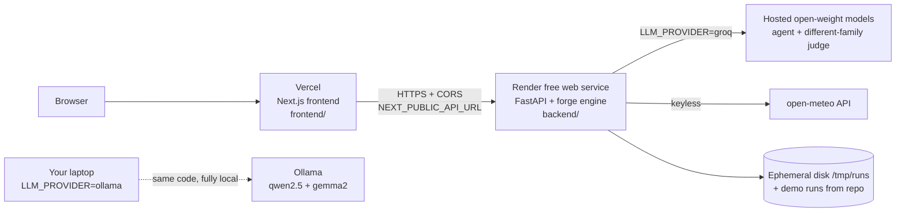

# Deploying ForgeAI (Render + Vercel)

> Blueprint only. These are the steps to follow in Phase 11, once the code exists.

## Architecture when hosted

## Why the LLM provider differs between laptop and Render

- Render's free tier has no GPU and about 512 MB RAM, so it cannot run Ollama with a 7B model.
- The engine talks only to `forge/llm/client.py`, which picks a provider from `LLM_PROVIDER`:
  - **Laptop and the official demo runs:** `ollama`. This is fully local and satisfies "judge = local small open model".
  - **Render:** `groq` (or `hf`). These are the same open-weight model families, hosted on a free API tier.
- The two committed demo runs are produced **locally with Ollama**. The hosted site replays them and can run new builds through the hosted provider. REPORT.md states which provider each run used.

## Step 1: push the repo to GitHub
One repo with `backend/` and `frontend/` folders (a monorepo). Check that `.env` files are not committed.

## Step 2: backend on Render
1. Render dashboard: New, then Blueprint, then pick the repo. Render reads `render.yaml` from the root.
2. Paste `GROQ_API_KEY` (a free key from Groq's console) when Render asks for the `sync: false` variables.
3. Leave `CORS_ORIGINS` as a placeholder for now; you will set it after Step 3.
4. Deploy, then open `https://<service>.onrender.com/health`. It should return `{"status":"ok"}`.
5. Open `/docs` to see the FastAPI Swagger UI.

## Step 3: frontend on Vercel
1. Vercel: Add New Project, import the repo, and set **Root Directory = `frontend`**. The framework is detected as Next.js.
2. Environment variable `NEXT_PUBLIC_API_URL = https://<service>.onrender.com` (plus `NEXT_PUBLIC_API_KEY` if you enabled one).
3. Deploy. You get `https://<app>.vercel.app`.
4. Go back to Render, set `CORS_ORIGINS=https://<app>.vercel.app,http://localhost:3000` and redeploy.

## Step 4: smoke test the hosted version
- The home page shows the backend status. The first load may say "waking up" for up to a minute.
- Open a demo run. All tabs should load from the committed artifacts.
- Chat with a demo agent and check that the answers include citations.
- Start a small new build in unattended mode (1 to 2 docs). Watch the stages finish and download the zip.

## Known limits on free tiers (say these in the report)
- A cold start takes about 30 to 60 s after idling.
- Live runs disappear when Render restarts, so download the zip. The demo runs always stay because they live in the repo.
- Hosted LLM rate limits slow down a full 24-case, 3-iteration build. The budget guard and rate limiter in `forge/llm/budget.py` handle this. For the official runs, build locally.
- Uploads are capped at 25 MB, and only one build runs at a time.
