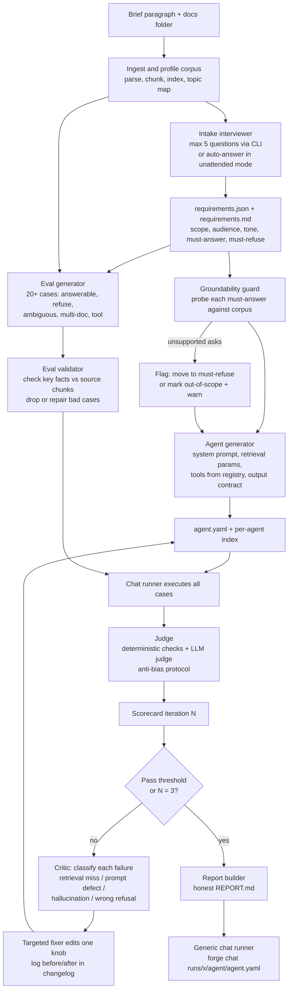

# ForgeAI: Build Plan

> OceanAI Jr GenAI Engineer campus assignment.
> **Goal:** a "factory" that takes a one-paragraph brief and a folder of documents, then, with no human in the loop, produces a **tested, self-improved, declaratively defined agent**, plus an honest report on how good it is.
>
> Status: **plan only.** No code is written yet. This document is the contract for the build.

---

## 0. Guiding principles

1. **Generality over demo polish.** At review an *unseen* brief runs unattended. Nothing may be hard-coded to the two demo domains. Every domain-specific thing (tone, tools, chunk size, refusal list) must come out of the pipeline, not out of code.
2. **Everything is an artifact on disk.** Each stage reads files and writes files (JSON/YAML/MD). That keeps stages restartable, diffable, and easy to commit as evidence.
3. **LLM output is never trusted raw.** Every LLM call that produces structure goes through *schema-constrained generation, then validate, then repair-retry, then a deterministic fallback.*
4. **Deterministic checks first, LLM judgment second.** Anything checkable by code (citations exist, refusal phrasing, numbers match a CSV, format) is checked by code. The LLM judge only scores what code cannot.
5. **Targeted fixes, not regeneration.** The optimizer edits *one* knob per failure class and logs a before/after score.
6. **Honesty is a feature.** The report must show failures, judge disagreement, and what was not fixed.

---

## 1. Stack choice and rationale

| Concern | Choice | Why | Fallback |
|---|---|---|---|
| Language | **Python 3.11** | Best ecosystem for RAG, evals, Ollama client | none needed |
| LLM runtime | **Ollama** (local) | Free, offline, reproducible, has a `format=<json schema>` option for constrained JSON | llama.cpp server |
| Builder / agent model | **`qwen2.5:7b-instruct`** (Q4_K_M) | Strong instruction following and JSON at 7B, good tool calling, runs on a laptop GPU or CPU | `llama3.2:3b` on low RAM |
| Judge model | **`gemma2:9b`** or **`llama3.1:8b`** (different family from the agent) | A different family from the generator reduces self-preference bias | `phi3.5` |
| Hosted LLM (Render) | **Groq free tier** serving open-weight models, behind `LLM_PROVIDER` | Render free has no GPU and ~512 MB RAM, so it can't run Ollama; the same model families are served by API | Hugging Face Inference |
| Embeddings | **`bge-small-en-v1.5`** via `fastembed` (ONNX, fits Render free) or `sentence-transformers` locally | Small (33M params), fast on CPU, good retrieval quality | `nomic-embed-text` via Ollama |
| Backend web | **FastAPI** + an in-process job queue, deployed on **Render** | Same engine as the CLI, async background builds, auto Swagger docs | none |
| Frontend | **Next.js + TypeScript + Tailwind**, deployed on **Vercel** | Free hosting, polished UI for the review, typed API client | none |
| Retrieval | **Hybrid: BM25 (`rank_bm25`) + dense**, fused with Reciprocal Rank Fusion; optional cross-encoder rerank (`bge-reranker-base`) | BM25 catches part numbers, codes, policy clause IDs that dense misses; dense catches paraphrase | dense only |
| Vector store | **Plain NumPy + JSON store** (Chroma optional locally) | Zero server, persists per agent, ships in the repo and on Render | Chroma |
| Document parsing | `pymupdf` (PDF, keeps page numbers), `python-docx`, `markdown`/plain text, `pandas` (CSV/XLSX) | Page-level provenance is needed for citations | `pypdf` |
| Schemas | **Pydantic v2** | One source of truth: validation, JSON schema export for Ollama `format`, docs | none |
| CLI | **Typer** + `rich` | Clean subcommands, nice interview prompts | argparse |
| Config | YAML (agent definitions) + `.env`-free `forge.toml` | Declarative, human-readable, diffable | JSON |
| Tests | `pytest`, `pytest-recording`/cached LLM fixtures | Fast offline unit tests | none |

> **What shipped (differs from this plan):** the laptop had no GPU, so 7-9B models were too slow. The models actually
> used are: agent `gpt-4o-mini` (OpenAI) or the fully local `qwen2.5:3b`; judge `llama3.2:3b` on local Ollama; on the
> hosted Streamlit app both are `gpt-4o-mini`, because its free host cannot run Ollama. The code defaults
> (`forge/config.py`), `backend/.env.example`, the READMEs and the user guide all use these names. The Render/Groq and
> Vercel deployment below was replaced by Streamlit Community Cloud (see `DEPLOY.md`).

**Local first, hosted when deployed:** the brief requires a local small open model for the judge, so the official demo runs and the review's unattended run use Ollama on the laptop (no keys, cost or rate limits). Because Mehul wants the project deployed on Render (backend) and Vercel (frontend), every LLM call goes through `LLMClient`, and a provider switch (`LLM_PROVIDER=ollama|groq|hf`) points the same code at a hosted open-weight model on Render. The report states which provider each run used. See `DEPLOY.md` and `PHASES.md` (the build phases that every file's header comment refers to).

**LLM call wrapper (`forge/llm.py`)**, used by every stage:

```
call(prompt_id, vars, schema=None, model=..., temperature=..., seed=...)
  1. render a versioned prompt template from prompts/<prompt_id>.md
  2. send to Ollama with format=<schema.model_json_schema()> if schema
  3. parse and validate with Pydantic
  4. on failure: send a repair prompt with the validation error (max 2 retries)
  5. on final failure: return a deterministic fallback, mark `degraded=True`
  6. log prompt hash, model, tokens, latency, cost-units to runs/<id>/llm_calls.jsonl
  7. cache by (prompt hash, model, seed) so reruns are cheap and reproducible
```

---

## 2. Repo layout

```
OceanAI/
├── PLAN.md                     <- this file
├── README.md                   <- quick start, architecture, how to run unseen brief
├── pyproject.toml
├── forge.toml                  <- models, budgets, thresholds, max iterations
├── forge/
│   ├── cli.py                  <- `forge build`, `forge chat`, `forge eval`, `forge report`
│   ├── llm.py                  <- Ollama client, constrained JSON, repair, cache, budget
│   ├── schemas/                <- Pydantic models (one file per artifact)
│   │   ├── requirements.py
│   │   ├── groundability.py
│   │   ├── agent_def.py
│   │   ├── eval_case.py
│   │   ├── scorecard.py
│   │   └── changelog.py
│   ├── ingest/                 <- loaders, chunkers, corpus profiler
│   ├── intake/                 <- interviewer (req 1)
│   ├── guard/                  <- groundability guard (req 2)
│   ├── generator/              <- agent generator (req 3)
│   ├── evals/                  <- eval generator + validator (req 4)
│   ├── judge/                  <- deterministic checks + LLM judge (req 5)
│   ├── optimizer/              <- critic, classifier, fixers, loop (req 6)
│   ├── report/                 <- report builder (req 7)
│   ├── runtime/                <- generic chat runner + retriever + tools (req 8)
│   │   └── tools/              <- csv_lookup, calculator, http_weather, current_date
│   └── pipeline.py             <- orchestrates stages, resumable, unattended mode
├── prompts/                    <- every generation prompt, versioned, committed (req 4)
├── demos/
│   ├── hr_policy/              <- brief.txt, docs/, answers.yaml (scripted interview)
│   └── ship_spares/            <- brief.txt, docs/ (CSV + supplier PDFs), answers.yaml
├── rehearsal/                  <- 3-5 surprise briefs used only to test generality
├── runs/                       <- one folder per factory run (all artifacts committed for demos)
│   └── <run_id>/
│       ├── requirements.md / requirements.json
│       ├── groundability.json
│       ├── agent/agent.yaml + index/
│       ├── evals/cases.jsonl + rejected.jsonl
│       ├── iterations/0..3/{scorecard.json, transcripts.jsonl}
│       ├── changelog.jsonl
│       ├── llm_calls.jsonl
│       └── REPORT.md
├── app/                        <- Gradio UI (stretch)
└── tests/
```

---

## 3. End-to-end flow



---

## 4. Module design, requirement by requirement

### 4.0 Ingest and corpus profile (foundation for everything)

- **Loaders:** PDF (per page, keep `page`), DOCX, MD/TXT, HTML, CSV/XLSX. Each produces `Document{doc_id, path, type, pages[]}`.
- **Tabular files are not chunked as prose.** CSVs are registered as **tables** (schema, column types, row count, 5 sample rows) and become candidates for the `csv_lookup` tool. A short text "table card" describing the CSV is still embedded so retrieval knows the table exists.
- **Chunker:** recursive by headings, then paragraphs, then sentences. Params (`chunk_size`, `overlap`) come from the agent definition so the optimizer can tune them. Each chunk keeps `chunk_id, doc_id, page, section_path, char_start, char_end, text`.
- **Corpus profile** (`corpus_profile.json`): doc list, page counts, detected language, section headings, top keywords per doc, numeric density, tables found, and an LLM-written 1-line summary per doc. This feeds the interviewer, guard, generator and eval generator, so they all reason about the *actual* docs.

### 4.1 Intake interviewer (Req 1)

**Input:** brief, corpus profile. **Output:** `requirements.json` + rendered `requirements.md`.

Design:
1. **Draft first, ask second.** The LLM drafts a full `Requirements` object from the brief + corpus profile, and marks each field with a confidence and the evidence it used.
2. **Question selection.** Fields with low confidence become candidate questions. Rank by *impact* (scope > must-refuse > audience > tone > format) and pick **at most 5**, hard-capped in code, not only in the prompt. Questions are closed-form where possible ("Should the agent answer questions about X? [y/n]") so answers are easy to parse.
3. **CLI loop** via `rich.prompt`. Empty answer means "use your default". Each answer is merged back into the draft by a small update prompt.
4. **Unattended mode:** no stdin. Questions are answered by (a) `answers.yaml` if present, else (b) a "proxy user" LLM call that answers conservatively from the brief, and every auto-answer is labelled `source: assumed` in the requirements doc and report.
5. **Validation:** must-answer list has at least 3 items, must-refuse has at least 2 items (always includes generic ones: out-of-corpus, personal/legal/medical advice where relevant, prompt-injection requests).

### 4.2 Groundability guard (Req 2)

**Input:** requirements, index. **Output:** `groundability.json`.

For every must-answer topic and every specific ask in the brief:
1. Generate 2 to 3 probe questions for the topic.
2. Retrieve top-k with the hybrid retriever and record scores.
3. Ask the LLM, constrained to a schema: "Do these chunks contain enough to answer? Quote the supporting span." Then **check the quote is a real substring** of a chunk (deterministic).
4. Verdict per ask: `supported` (quote verified), `partial`, `unsupported`, `needs_tool` (e.g. "today's weather", "current date", arithmetic over CSV columns, which the corpus can't hold but a tool can).
5. **Policy:** `unsupported` asks are moved to must-refuse with a reason and surfaced as warnings in CLI and report. `needs_tool` asks drive tool selection in 4.3. The brief is never silently expanded.

### 4.3 Agent generator (Req 3)

**Input:** requirements, groundability, corpus profile. **Output:** `agent.yaml` (declarative, see §5.2) + built index.

- **System prompt** composed from a fixed skeleton with slots (role, audience, tone, scope, refusal policy, citation rule, tool-use rules, output contract). The LLM fills the slots, the skeleton guarantees the non-negotiables (always cite, refuse when unsupported, never invent numbers) are present. This makes later targeted edits possible: the optimizer edits a slot, not the whole prompt.
- **Retrieval params** chosen by rules from the corpus profile, then refined by the optimizer: short FAQ-like docs give a small chunk size (≈350 tokens); long policy PDFs give ≈700 with 15% overlap; `top_k` 4 to 8; hybrid weight; rerank on/off; a `min_score` threshold below which the agent must refuse.
- **Tool selection** from a registry of 4 tools. Each tool declares `when_needed` signals. A tool is attached **only** if a signal fires:

| Tool | Attached when | Notes |
|---|---|---|
| `csv_lookup` | corpus contains a table, or an ask needs filtering/aggregation of tabular data | read-only, pandas, whitelisted ops (filter, select, sort, sum, count, min, max) on the registered files only |
| `calculator` | asks involve totals, conversions, leave balances, quantities × price | safe AST evaluator, no `eval` |
| `http_weather` (open-meteo, keyless) | an ask needs live weather or forecasts (e.g. port weather for a ship delivery) | timeout, allow-listed host only |
| `current_date` | asks are time-relative ("how many days until", "is this warranty still valid") | returns ISO date + weekday + timezone |

  Selection is logged with the reason. A test checks that the HR demo gets no weather tool.
- **Output contract** (part of the definition, enforced by the runner): JSON with `answer`, `citations[] {doc_id, page, quote}`, `tool_calls[]`, `refused: bool`, `refusal_reason`, `confidence`. The runner renders it to text for chat, but evals use the raw JSON.

### 4.4 Eval generator (Req 4)

**Input:** requirements, chunks, groundability, tools. **Output:** `evals/cases.jsonl` (≥ 20 valid cases) + `rejected.jsonl`.

**Case mix target (for 24 cases, adjusted if corpus is small):**

| Category | Count | How generated |
|---|---|---|
| Answerable, single doc | 8 | Sample chunks stratified across docs/sections; LLM writes Q + key facts + exact source quote |
| Answerable, multi-doc | 3 | Pair chunks with shared entities/keywords from different docs |
| Tool-needed | 2 to 3 | Only if tools attached (CSV lookup with computed gold answer, calculator, date) |
| Must-refuse | 5 | From must-refuse list + unsupported asks + one prompt injection + one out-of-domain |
| Ambiguous | 2 | Questions with two valid readings; expected behaviour is clarify or answer both with citations |
| Edge | 2 | Typos, very short query, a question whose answer is "the docs don't say" for a near-miss topic |

**Validation (the idea from earlier, made concrete):**
1. **Quote check:** `source_quote` must be a substring of the named chunk (normalized whitespace/case). Else, attempt fuzzy match (rapidfuzz ≥ 90) and repair, else reject.
2. **Key-fact check:** each key fact must appear in, or be entailed by, the source chunk. Literal or numeric facts are checked by string/number match; others by a small NLI-style LLM check.
3. **Refusal check:** a must-refuse case is rejected if hybrid retrieval finds a high-scoring chunk that actually answers it (it would not be a fair refusal).
4. **Tool case gold answers are computed by code** (run the actual pandas query), never by the LLM.
5. **De-duplication:** embedding similarity > 0.9 between questions means drop one.
6. Regenerate until ≥ 20 valid cases or budget is reached; report the rejection rate.

**Commit the generation prompts:** all prompts live in `prompts/` with a version header, and each run copies the exact rendered prompts used into `runs/<id>/prompts_used/`.

**Holdout:** 25% of cases are marked `split: holdout` and **never shown to the optimizer**. Final report shows train vs holdout score, which is how we show the loop isn't overfitting.

### 4.5 Judge (Req 5)

Two layers. A case's score is computed from both, and a deterministic hard failure cannot be overruled by the LLM judge.

**Layer A: deterministic checks (code)**
- `schema_valid`: output matches the contract.
- `citation_exists`: every cited `doc_id/page` exists.
- `citation_quote_verbatim`: each cited quote is a substring of that doc/page (the earlier idea). Fabricated quotes count as hallucination.
- `key_fact_coverage`: fraction of key facts present (string, number with tolerance, unit normalization).
- `numbers_grounded`: every number in the answer appears in a cited chunk or a tool result.
- `refusal_correct`: `refused` flag matches expectation; for must-refuse also checks no substantive leakage.
- `tool_correct`: expected tool was called and its result used; no forbidden tool called.
- `length_ok`, `latency_ms`.

**Layer B: LLM judge (local, different model family)**, scoring rubric items code can't: faithfulness to retrieved context, answers the actual question, tone/audience match, handling of ambiguity. Rubric is 1 to 5 per criterion with anchored descriptions; output is schema-constrained with a short rationale **written before** the score.

**Anti-bias design:**

| Bias | Defence |
|---|---|
| **Position bias** (in pairwise comparisons, used by the optimizer to compare before/after and by the tournament) | Every pairwise comparison is run twice with A/B swapped. Only a consistent win counts; inconsistent gives a tie. Position-flip agreement rate is reported. |
| **Self-preference** | Judge model is a different family from the agent/builder model. Answers are anonymized (no model names, no "iteration 2" labels). |
| **Verbosity bias** | Rubric explicitly says length is not quality; answers are compared against a **reference key-fact list** rather than "which is better" in isolation; a length-normalized check flags cases where the judge prefers the longer answer while key-fact coverage is equal. A max-length is in the output contract. |
| **Leniency / drift** | Temperature 0, fixed seed, cached. A small set of **calibration cases** with known-good and known-bad answers (including a fluent hallucination) runs each time; if the judge misses them, its scores are flagged as unreliable in the report. |
| **Judge sees gold answer?** | Yes, key facts only (not a full reference answer), to keep it grounded without rewarding copying style. |

**Per-case verdict:** `pass` if no hard deterministic failure AND key-fact coverage ≥ 0.8 AND judge mean ≥ 3.5 (thresholds in `forge.toml`). Scorecard aggregates by category.

### 4.6 Critic-optimizer loop (Req 6)

```
iteration 0: run evals -> scorecard_0
for i in 1..3:
    if score >= target or no fixable failures: stop
    failures = classify(scorecard_{i-1})
    pick the failure class with the largest expected gain
    apply ONE targeted fix (may touch one slot or param set)
    rerun the train split -> scorecard_i
    if score_i <= score_{i-1}: revert the fix, log "reverted", try the next class
    log change {before, after, diff, failure ids, rationale}
final: run holdout once on the best version
```

**Failure taxonomy and fix mapping** (classification is mostly rule-based on Layer A signals, with an LLM critic as tie-breaker):

| Class | Detection signal | Targeted fix |
|---|---|---|
| **Retrieval miss** | gold source chunk not in retrieved top-k (we know the gold chunk from eval generation) | Increase `top_k`; adjust hybrid weight toward BM25 if failed queries contain IDs/codes; enable rerank; change chunk size/overlap (rebuild index); add query rewriting / multi-query |
| **Prompt defect** | gold chunk *was* retrieved but key facts missing, wrong format, wrong tone, ignored tool | Edit the specific system-prompt slot (e.g. add "list every condition", format rule, tool-use rule) or add 1 few-shot example built from a *train* case |
| **Hallucination** | number/quote not grounded, fabricated citation, judge faithfulness ≤ 2 | Strengthen grounding slot ("only state facts present in the context"), require quote-per-claim, raise `min_score` refusal threshold, lower temperature |
| **Wrong refusal** (false refusal) | answerable case refused | Lower `min_score`, broaden scope slot with the missed topic, check retrieval (often actually a retrieval miss) |
| **Wrong answer to must-refuse** (false compliance) | must-refuse case answered | Add the topic to refusal slot with an example; raise `min_score` |
| **Tool error** | wrong/missing tool call, tool exception | Tool description wording, tool-use rule in prompt, argument examples |

**Change log entry** (append-only `changelog.jsonl`, see §5.5). Every change includes the exact diff of `agent.yaml`, the failing case IDs that motivated it, before/after overall and per-category scores, and whether it was kept or reverted.

### 4.7 Honest report (Req 7)

`REPORT.md` generated from artifacts (numbers come from JSON, never from the LLM). The LLM writes only short narrative paragraphs, which are fed the numbers.

Sections: run summary and config; requirements and which answers were assumed; groundability warnings; agent definition summary and tool choices with reasons; eval mix and rejection rate; scores per iteration (table + simple chart), per category, train vs holdout; changelog table; **known failures** (still-failing cases with transcripts); judge reliability (calibration results, position-flip agreement, judge vs deterministic disagreement); limitations and what I would do next; cost/time (tokens, wall-clock).

### 4.8 Generic chat runner (Req 8)

`forge chat <path/to/agent.yaml>`: loads **any** definition; nothing about the domain is in code.
- Builds or loads the index declared in the definition, registers only the declared tools.
- Loop: retrieve, then the model with tool-calling (Ollama native tools; fallback to a JSON "action" protocol), max 3 tool hops, then output contract validation and repair, then render answer + citations.
- Same runner is used by the eval harness (`run_case`) so what is tested is what ships.
- Also `forge ask <agent.yaml> "question" --json` for scripting.

### 4.9 Demo runs (Req 9)

Two deliberately different briefs (see §7). Each run's whole `runs/<id>/` folder is committed: requirements, guard output, agent definition, evals, all scorecards, changelog, transcripts, LLM call log, report.

---

## 5. Schemas (Pydantic, summarized)

### 5.1 Requirements
```yaml
run_id: str
brief: str
scope: {in_scope: [str], out_of_scope: [str]}
audience: {who: str, expertise: novice|intermediate|expert}
tone: {style: str, formality: low|medium|high, language: str}
must_answer: [{id: str, topic: str, example_question: str, priority: 1-3}]
must_refuse: [{id: str, topic: str, reason: str, source: brief|guard|default}]
output_preferences: {format: prose|bullets|table, max_words: int, citations: required}
interview: [{question: str, answer: str, source: user|answers_file|assumed}]
assumptions: [str]
```

### 5.2 Agent definition (`agent.yaml`)
```yaml
schema_version: 1
name: str
version: int                  # bumped by each optimizer change
description: str
model: {name: str, temperature: float, seed: int, max_tokens: int}
system_prompt:
  slots: {role, audience, tone, scope, refusal_policy, grounding, citation_rule,
          tool_rules, format}           # editable individually
  few_shots: [{q: str, a: str}]
  rendered: str                          # derived, for readability
corpus:
  paths: [str]
  tables: [{name, path, columns: [{name, dtype}]}]
retrieval:
  chunk_size: int
  chunk_overlap: int
  embedder: str
  mode: hybrid|dense|bm25
  bm25_weight: float
  top_k: int
  rerank: bool
  min_score: float              # below this, refuse
  query_rewrite: bool
tools: [{name: csv_lookup|calculator|http_weather|current_date,
         reason: str, config: {}}]
output_contract:
  json_schema_ref: answer_v1
  require_citations: true
  max_words: int
refusal_message: str
provenance: {built_from_run: str, requirements_hash: str, created_at: str}
```

### 5.3 Eval case
```yaml
id: str
category: answerable|multi_doc|tool|must_refuse|ambiguous|edge
split: train|holdout
question: str
expected_behavior: answer|refuse|clarify
key_facts: [{fact: str, kind: literal|numeric|semantic, value: optional}]
sources: [{doc_id, page, chunk_id, quote}]
expected_tools: [str]
forbidden_tools: [str]
notes: str
generation: {prompt_id: str, prompt_version: str, validated: bool, repairs: [str]}
```

### 5.4 Scorecard
```yaml
run_id, iteration, agent_version
summary: {pass_rate, mean_judge, key_fact_coverage, hallucination_rate,
          refusal_precision, refusal_recall, by_category: {cat: pass_rate}}
judge_reliability: {calibration_pass: bool, flip_agreement: float}
cases: [{case_id, verdict: pass|fail, deterministic: {check: bool|float},
         judge: {criterion: score, rationale}, failure_class: optional,
         retrieved_chunk_ids, gold_in_topk: bool, latency_ms, tokens}]
```

### 5.5 Change log entry
```yaml
iteration: int
timestamp: str
failure_class: str
target_case_ids: [str]
hypothesis: str
change: {path: "retrieval.top_k", before: 4, after: 8}   # or a slot text diff
score_before: {overall: float, by_category: {}}
score_after: {overall: float, by_category: {}}
kept: bool
reverted_reason: optional str
```

---

## 6. Unattended mode (for the unseen review brief)

`forge build --brief brief.txt --docs ./docs --unattended`

- No prompts; interviewer answers come from `answers.yaml` if present, else conservative assumptions, all labelled.
- Every stage has a **deterministic fallback**, so the pipeline never crashes on bad LLM output: default requirements template, default retrieval params, rule-based tool selection, template-based eval cases from chunks, deterministic-only judging if the judge model fails.
- **Resumable:** each stage writes a `.done` marker; rerun skips completed stages (`--from stage` to force).
- **Budget guard** (also a stretch goal): max LLM calls / tokens / wall-clock in `forge.toml`; when near the limit, skip optional steps (rerank tuning, tournament) and go straight to the report, noting it.
- **Input robustness:** empty/unreadable files are skipped and reported; scanned PDFs with no text are flagged (OCR as optional extra); non-English docs detected and tone/language set accordingly; very large folders are sampled for eval generation.
- **Pre-flight check:** Ollama reachable, models pulled, disk space, docs folder non-empty. Clear error messages.
- Exit code 0 with a report even when quality is low; the report says so.

---

## 7. Demo data plan

| | Demo A: HR policy assistant | Demo B: Ship spares procurement assistant |
|---|---|---|
| Brief | "An assistant for new employees at a mid-size company to answer questions about leave, travel, expenses, code of conduct; must not give legal advice or discuss individual salaries." | "An assistant for a ship's chief engineer to find spare parts, compatible part numbers, supplier lead times and prices, estimate order cost, and check weather at the delivery port." |
| Docs | 4 to 6 policy PDFs/MD (leave, travel and expenses, code of conduct, WFH, benefits), 20 to 40 pages total | `spares_inventory.csv` (≈300 rows: part no, description, equipment, qty, min stock, unit price, supplier id), `suppliers.csv`, 3 to 4 supplier catalogue/terms PDFs (lead times, MOQ, warranty) |
| Tools expected | `calculator` (leave days, per-diem), `current_date` (days of leave remaining this year); **no** CSV, **no** weather | `csv_lookup`, `calculator`, `http_weather` (port forecast via open-meteo), `current_date` (lead-time ETA) |
| Tests generality on | prose retrieval, refusals, tone | tabular + prose mix, tools, numeric grounding |
| Source | Write original synthetic docs for a fictional company (no real company branding), or use clearly public-domain/openly licensed sample policies | Synthetic, generated by a script with fixed seed, plus written supplier terms for fictional suppliers |

**Rehearsal set (not demoed, used for generality testing):** 3 to 5 surprise briefs, e.g. a product FAQ/manual, a university course handbook, a recipe/nutrition CSV, a tiny 1-doc corpus, and a brief that mostly asks for things the docs can't support (tests the guard). The factory runs on these unattended before review; failures become bug fixes in *generic* code only.

---

## 8. Testing strategy

- **Unit tests (offline, fast):** chunker boundaries and provenance, BM25+dense fusion, each tool (calculator safety, csv ops whitelist, weather timeout mock, date), deterministic judge checks (citation substring, number grounding), schema validation and repair logic with fake LLM outputs, tool selector rules, question cap of 5.
- **Golden fixture tests:** a tiny 3-doc corpus with hand-written expected outputs for guard, eval validation and scorer.
- **LLM-in-the-loop tests (marked `slow`):** run with cached responses (`llm_calls` cache) so CI is deterministic; refresh the cache manually.
- **Judge meta-eval:** 15 hand-labelled answer/verdict pairs; measure judge agreement with me (target ≥ 80%) and position-flip consistency. Reported.
- **End-to-end smoke:** `forge build` on the tiny corpus in unattended mode under 5 minutes.
- **Generality:** rehearsal briefs in §7, plus a "no-tool" and "all-tools" brief.
- **Regression mode (stretch):** `forge eval --against runs/<old>` reruns a frozen eval set on a new agent version and diffs per-case verdicts.

---

## 9. Milestones and order of work

Order is chosen so that there is a runnable end-to-end skeleton early, and every later step improves something measurable.

| # | Milestone | Deliverable | Est. |
|---|---|---|---|
| M0 | Setup | repo, pyproject, Ollama models pulled, `llm.py` with constrained JSON + repair + cache + logging, schemas | 0.5 day |
| M1 | Ingest + retrieval | loaders, chunker, hybrid retriever, corpus profile, unit tests | 1 day |
| M2 | Runtime (Req 8) | tool registry (4 tools), chat runner, output contract; hand-written `agent.yaml` works on Demo A docs | 1 day |
| M3 | Intake + guard (Req 1, 2) | interviewer with 5-question cap, unattended answers, groundability guard | 1 day |
| M4 | Agent generator (Req 3) | slot-based prompt, retrieval param rules, tool selection with reasons | 0.5 day |
| M5 | Eval generator + validator (Req 4) | ≥ 20 validated cases, holdout split, prompts committed | 1 day |
| M6 | Judge (Req 5) | deterministic checks, LLM judge, anti-bias protocol, calibration set, judge meta-eval | 1 day |
| M7 | Optimizer (Req 6) | classifier, fixers, revert-on-regress, changelog, 3-iteration cap | 1 day |
| M8 | Report + pipeline (Req 7) | `forge build` end-to-end, resumable, unattended, REPORT.md | 0.5 day |
| M9 | Demos (Req 9) | build both demo corpora, run both, commit artifacts | 1 day |
| M10 | Generality hardening | rehearsal briefs, fix generic bugs, README | 0.5 to 1 day |
| M11 | Stretch goals | in the priority order of §10 | remaining time |

Total core: about 9 to 10 working days. If time is short, M10 is not skipped; stretch goals are.

---

## 10. Stretch goals, prioritized

Ordered by value to the reviewer divided by effort:

1. **Budget enforcement** — cheap, mostly already in `llm.py`; makes unattended runs safe. *(do first)*
2. **Regression mode** — reuses the eval harness; strong evidence the optimizer helps.
3. **Human checkpoint** — `--checkpoint` pauses after requirements and after the agent definition for an optional edit; trivial with file-based stages.
4. **Factory vs human baseline** — I hand-write an agent.yaml for Demo A and score both on the same evals. Honest, compelling comparison.
5. **Prompt tournament** — generate 3 system-prompt variants, pairwise judge with position swap, keep the winner. Reuses the anti-bias pairwise judge.
6. **Gradio UI hosted free** — upload brief + docs, watch stages, chat with result. Hosting a model is the hard part (see risks); likely host the **chat runner + precomputed demo agents** with a small model, and document local mode for full builds.

---

## 11. Key risks and mitigations

| Risk | Impact | Mitigation |
|---|---|---|
| Small local model produces broken JSON | pipeline crashes | Ollama `format` schema, repair retries, deterministic fallbacks, `degraded` flags |
| Eval cases generated by the same model are too easy or wrong | inflated scores | substring and key-fact validation against chunks, holdout split, code-computed tool gold answers, human spot check of 10 cases per demo reported |
| Judge unreliable at 7 to 9B | noisy scores | deterministic checks dominate pass/fail, calibration cases, judge meta-eval, flip agreement reported |
| Optimizer overfits the eval set | fake improvement | holdout split never seen by optimizer, revert-on-regress, one change per iteration |
| Slow on a laptop (CPU only) | demo takes hours | 3B fallback model, caching, small embedder, limit to 24 evals, budget guard |
| Unseen brief has weird docs (scans, huge, non-English, tables only) | crash or garbage | input robustness rules in §6, rehearsal briefs, every stage has a fallback |
| Unseen brief needs a tool not in the registry | can't satisfy ask | guard marks it `unsupported`, moves to must-refuse, report says so clearly |
| Render free can't run Ollama (no GPU, 512 MB RAM, sleeps, ephemeral disk) | hosted builds slow or lost | provider switch to Groq on Render, fastembed instead of torch, one build at a time, demo runs committed in the repo, zip download for live runs, "waking up" state in the UI |
| Hosted judge is not "local" | requirement mismatch | official demo and review runs use Ollama locally; the hosted site is a showcase, and the report says which provider ran |
| Copyrighted demo docs | can't commit | synthetic documents for fictional organisations, or openly licensed sources |
| Windows path / encoding issues | bugs on review machine | `pathlib` everywhere, UTF-8 explicit, test on Windows and in a Linux container |

---

## 12. Definition of done (mapped to the 9 requirements)

- [ ] R1: interviewer asks ≤ 5 questions, writes requirements doc with scope, audience, tone, must-answer, must-refuse
- [ ] R2: guard output lists every unsupported ask with evidence, and the agent refuses them
- [ ] R3: `agent.yaml` is fully declarative; only needed tools attached, with reasons
- [ ] R4: ≥ 20 validated cases across all categories; generation prompts committed
- [ ] R5: local judge + deterministic checks; anti-bias measures implemented and measured
- [ ] R6: up to 3 iterations, failures classified, targeted fixes, every change logged with before/after
- [ ] R7: REPORT.md shows weaknesses, holdout score, judge reliability
- [ ] R8: `forge chat` runs any agent definition, including a hand-written one
- [ ] R9: two complete demo runs committed with all artifacts
- [ ] Unattended `forge build` passes on all rehearsal briefs without crashing

---

## 13. Open questions for Mehul

1. Hardware: do you have an NVIDIA GPU, and how much RAM? This decides 7B vs 3B models.
2. Do you want the demo docs fully synthetic (safest for committing), or do you have real public documents in mind?
3. Any deadline? It decides how many stretch goals fit.
4. Should the repo live in this `OceanAI` folder with git initialised here, and pushed to a GitHub repo of yours?
