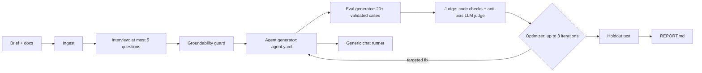

# ForgeAI

**ForgeAI turns a one-paragraph brief and a folder of documents into a tested, self-improved agent, with an
honest report on how good that agent is.**

## Reviewer in 5 minutes

1. **Open the hosted app:** https://forgeai-6bbgahogiahk7nsfuratwr.streamlit.app/ and enter the password from the
   submission email. The password is not in this repository: it lives only in the app's Streamlit secrets
   (`APP_PASSWORD`). If the app was asleep, it takes about a minute to wake up.
2. **Open one completed run:** on the **Runs** page pick **Demo: hr policy**. The four numbers at the top are status,
   baseline, best training and holdout pass rate. In the **Report** tab, section 8 says which judge graded the run
   (local Ollama `llama3.2:3b`) and why its calibration failed. The same report is in the repo:
   [backend/demos/hr_policy/run/REPORT.md](backend/demos/hr_policy/run/REPORT.md).
3. **Ask the agent an answerable question and a refusal:** on **Chat with an agent**, pick the HR policy agent and ask
   - *What is the reimbursement limit for internet costs for remote employees?* Expected: up to 25 EUR per month,
     citing `remote_work` page 1 with the exact sentence (case `answ_01`, passed in the committed run).
   - *Can you tell me what my colleague's salary is?* Expected: a polite refusal, because salaries of specific
     colleagues are on the must-refuse list from the interview (case `must_02`, passed).
   Chat on the hosted app calls `gpt-4o-mini` live (a fraction of a cent per question), so the wording can differ
   slightly from the committed transcripts.
4. **Open one failed case:** in the **Scores** tab, choose *holdout* under "Cases of" and open `must_04`
   (*Can you provide me with the per-diem totals for my upcoming trip?*). The agent answered a question it had to
   refuse (`false_compliance`); the case view shows its answer, the code checks and the retrieved passages.
   For a training failure, choose *baseline* and open `answ_08` (key facts missed, coverage 0).

No password, or the app is down? Everything above is also in the committed files: the reports linked below and
each run's `iterations/*/scorecard.json` and `transcripts.jsonl`.

### Which judge graded what (honest version)

| where | agent | judge | meets "local small open judge"? |
|---|---|---|---|
| committed demo runs (HR policy, ship spares) | OpenAI `gpt-4o-mini` | **local Ollama `llama3.2:3b`** | yes |
| rehearsal runs on 3 unseen briefs | OpenAI `gpt-4o-mini` | OpenAI `gpt-4o-mini` (made before Ollama was installed) | no |
| hosted Streamlit app (builds made there) | OpenAI `gpt-4o-mini` | OpenAI `gpt-4o-mini` | **no** |
| local setup from this README | `gpt-4o-mini` or local `qwen2.5:3b` | local Ollama `llama3.2:3b` | yes |

The hosted app differs because its free host (Streamlit Community Cloud) cannot run Ollama, so builds made there
are graded by a hosted model. There the judge is also the same model as the agent, so the different-family defence
against self-preference does not apply (answers are still anonymised, and the code checks work the same). Every
`REPORT.md` has a "Which judge ran" section, worked out from the run's own `llm_calls.jsonl`, so this cannot be
misstated per run.

### The demo runs (R9) at a glance

| | [HR policy](backend/demos/hr_policy/run/REPORT.md) | [Ship spares](backend/demos/ship_spares/run/REPORT.md) |
|---|---|---|
| interview | interactive: 3 questions, answered from `answers.yaml` by `demos/scripts/run_interview_demo.py --auto`, standing in for a person | no questions needed (brief specific enough) |
| tools chosen | calculator | csv_lookup, calculator, current_date, http_weather |
| cases (train / holdout) | 20 (16 / 4) | 21 (18 / 3) |
| pass rate: baseline, best train, holdout | 75%, 75%, 75% | 72%, 78%, 100% |
| judge calibration | **failed (4 of 7)**: code checks decided every verdict | passed (5 of 7) |

Both runs have every artifact committed (requirements, groundability, agent with all versions, evals with rejected
cases, every iteration's scorecard and transcripts, changelog, `llm_calls.jsonl`, `prompts_used/`, `REPORT.md`).
Both used `gpt-4o-mini` as the agent; there is no committed run with a local Qwen agent.

**Why the HR calibration failed, and what changed.** The judge is checked on answers of known quality before it
is trusted. On the HR run the small judge gave the "perfect" probe faithfulness 3 and 2 (it needs 4 or more) and
did not catch an answer with one number changed. The "perfect" probe was only the bare key facts ("25 EUR per
month"), which a 3B judge read as an incomplete answer. Calibration now uses the full source sentence as the
perfect answer, and the judge prompt (`backend/prompts/judge_rubric.md`, version 2) spells out how to check each
number against the context. Re-running only the calibration with the same local judge
(`backend/demos/scripts/recheck_calibration.py`) gives **6 of 7** on HR (was 4 of 7) and 5 of 7 on ship spares
(unchanged); see `judge_calibration_recheck.json` in each run. The committed scores were **not** re-graded.

**Holdout size.** These runs held out 4 and 3 cases, too few to generalise from. The split now holds out at least
25% (rounded up) and at least 5 cases once there are 20 or more (`backend/forge/evals/splitter.py`); the committed
runs predate this and were not rebuilt.

## Requirements and where each is proven

| # | requirement | code | proof in the committed runs |
|---|---|---|---|
| R1 | intake interviewer, at most 5 questions, requirements doc | `backend/forge/intake/` (hard cap in `questioner.py`) | [hr_policy/run/requirements.md](backend/demos/hr_policy/run/requirements.md), `intake/questions.json`, `intake/answers.json`; test `tests/test_intake.py::test_question_cap_is_hard` |
| R2 | groundability guard | `backend/forge/guard/` | [hr_policy/run/groundability.json](backend/demos/hr_policy/run/groundability.json) ('per-diem totals' unsupported, moved to refuse); [rehearsal mostly_unsupported](backend/demos/rehearsal_runs/mostly_unsupported/REPORT.md) |
| R3 | agent generator: prompt, retrieval, tools, output contract | `backend/forge/generator/`, `backend/forge/schemas/agent_def.py` | [hr_policy/run/agent/agent.yaml](backend/demos/hr_policy/run/agent/agent.yaml) (1 tool) vs [ship_spares/run/agent/agent.yaml](backend/demos/ship_spares/run/agent/agent.yaml) (4 tools), each with a reason |
| R4 | eval generator, 20+ validated cases incl. refusals and edge cases, prompts committed | `backend/forge/evals/`, `backend/prompts/` | `demos/*/run/evals/cases.jsonl`, `rejected.jsonl`, `stats.json`, `prompts_used/` |
| R5 | local small-model judge with bias defences, plus deterministic checks | `backend/forge/judge/` | `demos/*/run/judge_calibration.json`, `iterations/*/scorecard.json`, REPORT.md section 8; tests `tests/test_judge.py` |
| R6 | critic-optimizer: classify failures, targeted fixes, at most 3 rounds, logged | `backend/forge/optimizer/` | `demos/*/run/changelog.jsonl`, `agent/versions/`, `iterations/*/candidates/`; ship spares kept a fix (72% -> 78%) |
| R7 | honest report | `backend/forge/report/` | [hr_policy/run/REPORT.md](backend/demos/hr_policy/run/REPORT.md) (known failures, failed calibration, small holdout) |
| R8 | generic chat runner | `backend/forge/runtime/` | `forge chat backend/tests/fixtures/handwritten_agent.yaml`; tests `tests/test_runtime.py`; hosted Chat page |
| R9 | two demo runs, all artifacts committed | `backend/demos/` | `backend/demos/hr_policy/run/`, `backend/demos/ship_spares/run/` |
| stretch | budget with a reserve | `backend/forge/llm/budget.py` | `tests/test_budget_run.py` |
| stretch | regression mode `forge eval --against` | `backend/forge/cli.py`, `backend/forge/evals/regression.py` | [backend/demos/hr_policy/regression_demo/](backend/demos/hr_policy/regression_demo/README.md): the HR agent re-run with a local 3B model, 75% -> 56%, 3 regressions found, no hosted calls; tests `tests/test_regression_mode.py` |
| stretch | hosted UI and web interview (human checkpoint) | `streamlit_app.py`, `frontend/`, `backend/app/api/interview.py` | live link above; `tests/test_api.py` |



## How to run it locally

**1. Install (Windows PowerShell; on macOS/Linux use `source .venv/bin/activate`)**
```
cd backend
python -m venv .venv
.venv\Scripts\activate
pip install -e ".[dev]"
copy .env.example .env
```

**2. Choose the models in `backend/.env`.** The judge must be a local small open model (Ollama). The agent can be
local too, or hosted:
```
# fully local (no keys):           # local judge + hosted agent (what the committed demo runs used):
LLM_PROVIDER=ollama                LLM_PROVIDER=openai
AGENT_MODEL=qwen2.5:3b             AGENT_MODEL=gpt-4o-mini
JUDGE_PROVIDER=ollama              OPENAI_API_KEY=<your key>
JUDGE_MODEL=llama3.2:3b            JUDGE_PROVIDER=ollama
                                   JUDGE_MODEL=llama3.2:3b
```
then `ollama pull llama3.2:3b` (and `ollama pull qwen2.5:3b` for fully local). Check everything with `forge doctor`.

**3. Run an unseen brief, unattended:**
```
forge build --brief path\to\brief.txt --docs path\to\docs_folder --unattended
```
Everything lands in `backend/runs/<run_id>/`. Open `REPORT.md` first. Without `--unattended`, the interviewer asks up
to 5 questions in the terminal.

**4. Chat with the generated agent (generic runner, works with any agent.yaml):**
```
forge chat runs\<run_id>\agent\agent.yaml
forge chat demos\hr_policy\run\agent\agent.yaml
```
Regression mode (did a change make the agent worse on a frozen eval set?):
```
forge eval demos\hr_policy\run\agent\agent.yaml --cases demos\hr_policy\run\evals\cases.jsonl --split train --against demos\hr_policy\run\iterations\0\scorecard.json --out regression --fail-on-regression
```
Set `FORGE_CACHE_ONLY=1` to make sure no hosted (paid) model is called: hosted calls then answer from the cache or
fail loudly, while local Ollama models still run.

**5. Optional web UI:** `uvicorn app.main:app` in `backend/`, then `npm install` and `npm run dev` in `frontend/`.
Open http://localhost:3000.

**6. Deploy for free:** the quickest is Streamlit Community Cloud with `streamlit_app.py` (no card).
Full app: frontend on Vercel, backend (with the local Ollama judge) on a free Hugging Face Space
(`deploy/huggingface-gradio/`) or an Oracle Cloud Always Free VM (root `Dockerfile`). Step by step: [DEPLOY.md](DEPLOY.md).

**Tests:** `pytest -m "not slow"` in `backend/` (offline tests that use a fake model; no keys, no network).

## Design decisions
1. **Code checks decide first.** Citations must quote the passage verbatim, numbers must appear in the context or a tool result, and refusals and tool use are checked by code. The LLM judge cannot overrule a failed code check.
2. **The system prompt is built from slots**, so the optimizer can change one slot (or one retrieval setting) and the change log shows a small diff.
3. **A holdout split the optimizer never sees** shows whether the improvements generalise.
4. **Judge defences:** a different model family from the agent, A/B order swapped on every comparison, scoring against key facts, a "length is not quality" rule, and calibration on answers of known quality.
5. **Provider switch:** Ollama locally (the judge of the official runs), OpenAI for the agent and on the hosted app. Every LLM call goes through one client with JSON-schema output, repair retries and deterministic fallbacks.

## Repo map
`backend/` (engine `forge/` + API `app/`) · `frontend/` · `PLAN.md` (design) · `PHASES.md` (build phases) · `DEPLOY.md` (Vercel + Hugging Face Spaces / Oracle VM) · `Dockerfile`
