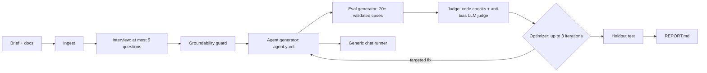

# ForgeAI

**ForgeAI turns a one-paragraph brief and a folder of documents into a tested, self-improved agent, with an
honest report on how good that agent is.**

- Demo reports: [HR policy](backend/demos/hr_policy/run/REPORT.md) · [Ship spares](backend/demos/ship_spares/run/REPORT.md) (built in interactive mode: the interviewer asked 3 questions, see `requirements.md`)
- Rehearsal runs on 3 unseen briefs, all unattended: `backend/demos/rehearsal_runs/`



## How to run it (reviewer steps)

**1. Install (Windows PowerShell; on macOS/Linux use `source .venv/bin/activate`)**
```
cd backend
python -m venv .venv
.venv\Scripts\activate
pip install -e ".[dev]"
copy .env.example .env
```

**2. Choose the models in `backend/.env`.** The judge must be a local small open model (Ollama). The agent can be
local too, or hosted:
```
# fully local (no keys):           # local judge + hosted agent (what the committed demo runs used):
LLM_PROVIDER=ollama                LLM_PROVIDER=openai
AGENT_MODEL=qwen2.5:3b             AGENT_MODEL=gpt-4o-mini
JUDGE_PROVIDER=ollama              OPENAI_API_KEY=<your key>
JUDGE_MODEL=llama3.2:3b            JUDGE_PROVIDER=ollama
                                   JUDGE_MODEL=llama3.2:3b
```
then `ollama pull llama3.2:3b` (and `ollama pull qwen2.5:3b` for fully local). Check everything with `forge doctor`.

**3. Run an unseen brief, unattended:**
```
forge build --brief path\to\brief.txt --docs path\to\docs_folder --unattended
```
Everything lands in `backend/runs/<run_id>/`. Open `REPORT.md` first. Without `--unattended`, the interviewer asks up
to 5 questions in the terminal.

**4. Chat with the generated agent (generic runner, works with any agent.yaml):**
```
forge chat runs\<run_id>\agent\agent.yaml
forge chat demos\hr_policy\run\agent\agent.yaml
```

**5. Optional web UI:** `uvicorn app.main:app` in `backend/`, then `npm install` and `npm run dev` in `frontend/`.
Open http://localhost:3000.

**Tests:** `pytest -m "not slow"` in `backend/` (55 offline tests that use a fake model).

## Requirements map
| # | requirement | code | evidence in each run |
|---|---|---|---|
| R1 | intake interviewer, at most 5 questions | `backend/forge/intake/` | `requirements.md` |
| R2 | groundability guard | `backend/forge/guard/` | `groundability.json` |
| R3 | agent generator (prompt, retrieval, tools, contract) | `backend/forge/generator/` | `agent/agent.yaml` |
| R4 | eval generator, 20+ validated cases, prompts committed | `backend/forge/evals/`, `backend/prompts/` | `evals/`, `prompts_used/` |
| R5 | judge: local small model with anti-bias checks, plus deterministic checks | `backend/forge/judge/` | `iterations/*/scorecard.json`, `judge_calibration.json` |
| R6 | critic-optimizer, at most 3 iterations, every change logged | `backend/forge/optimizer/` | `changelog.jsonl`, `agent/versions/` |
| R7 | honest report | `backend/forge/report/` | `REPORT.md` |
| R8 | generic chat runner | `backend/forge/runtime/` | `forge chat <agent.yaml>`, `/agents/*/chat` |
| R9 | two demo runs | `backend/demos/` | `demos/*/run/` |
| stretch | budget, regression mode, UI hosted for free, human checkpoint (web interview) | `llm/budget.py`, `forge eval`, `frontend/` | |

## Design decisions
1. **Code checks decide first.** Citations must quote the passage verbatim, numbers must appear in the context or a tool result, and refusals and tool use are checked by code. The LLM judge cannot overrule a failed code check.
2. **The system prompt is built from slots**, so the optimizer can change one slot (or one retrieval setting) and the change log shows a small diff.
3. **A holdout split the optimizer never sees** shows whether the improvements generalise.
4. **Judge defences:** a different model family from the agent, A/B order swapped on every comparison, scoring against key facts, a "length is not quality" rule, and calibration on answers of known quality.
5. **Provider switch:** Ollama locally (official runs), a hosted open-weight model on Render. Every LLM call goes through one client with JSON-schema output, repair retries and deterministic fallbacks.

## Repo map
`backend/` (engine `forge/` + API `app/`) · `frontend/` · `PLAN.md` (design) · `PHASES.md` (build phases) · `DEPLOY.md` (Render + Vercel)
