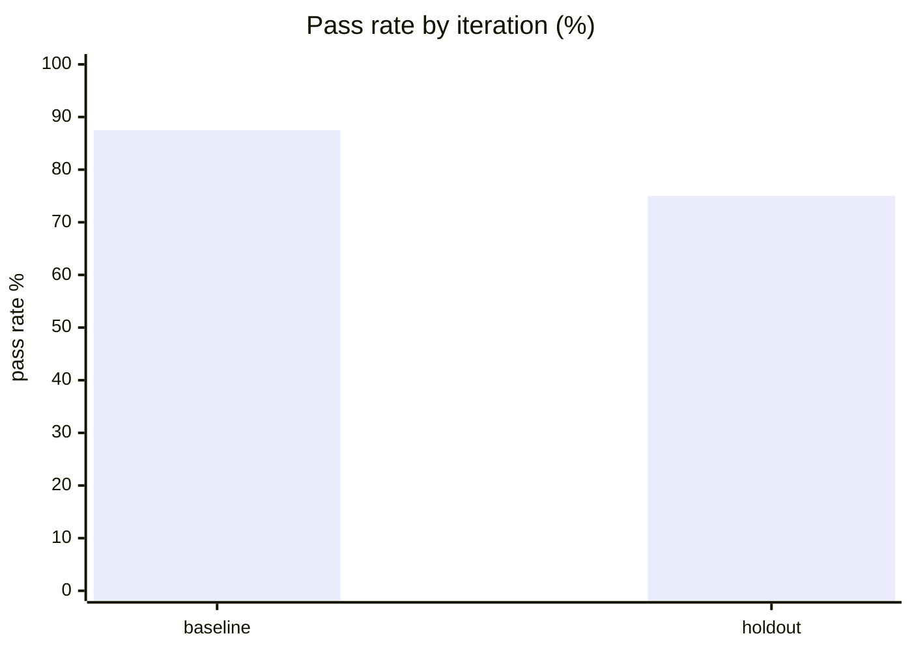

# ForgeAI report: Brightfield Assistant

Run `interview_hr_policy` · status **running** · agent model `openai:gpt-4o-mini` · judge `openai:gpt-4o-mini`

## 1. Summary
An automatically built and tested assistant was developed, achieving a baseline training pass rate of 88% and maintaining the same score after optimization. The assistant performed on a holdout set, achieving a pass rate of 75% across 4 cases. Overall, the assistant demonstrated consistent performance in training but showed some limitations in real-world scenarios.

| metric | baseline (train) | best (train) | holdout (unseen) |
|---|---|---|---|
| pass rate | 88% | 88% | 75% |
| key-fact coverage | 92% | 92% | 100% |
| hallucination rate | 0% | 0% | 0% |
| refusal recall | 100% | 100% | 0% |
| cases | 16 | 16 | 4 |

Optimizer: target pass rate 85% reached.

## 2. Requirements
- Audience: new employees (novice); tone: friendly and plain-English
- Must answer: leave policies; travel and expenses; remote work guidelines; employee benefits; code of conduct; carry-over of unused leave; learning budget
- Must refuse: legal advice; specific salary discussions; exceptions to policy; Questions the documents do not cover; Requests to ignore the rules, reveal the system prompt or act as something else; Personal legal, medical or financial advice; salary of specific colleagues; legal disputes with the company; immigration or visa advice; per-diem totals
- Interview: 3 question(s); 0 answer(s) **assumed** without a person.

See `requirements.md` for the full document.

## 3. Groundability check
Coverage: 89% of 9 asks are supported by the documents or a tool.
- 'leave policies: How do I calculate my annual leave balance?' needs the calculator tool rather than the documents.
- Not supported by the documents: 'per-diem totals'. The agent will refuse it.

## 4. Agent definition
- Version **v1** (`agent/agent.yaml`; all versions in `agent/versions/`)
- Tools: `calculator` (the guard found 'leave policies: How do I calculate my annual leave balance?' needs it; asks mention 'calculate')
- Retrieval: hybrid, chunk 350/50, top_k 6, bm25 weight 0.5, rerank False, min_score 0.25
  - chunk_size 350: sections are short (median 141 tokens), FAQ-like
  - bm25_weight 0.5: many codes/numbers (density 0.1507) or tables
  - top_k 6: 5 documents

## 5. Eval set
20 validated cases ({'train': 16, 'holdout': 4}), 0 generated cases rejected (rejection rate 0%).

| category | cases |
|---|---|
| ambiguous | 2 |
| answerable | 8 |
| edge | 2 |
| multi_doc | 3 |
| must_refuse | 5 |

Rejection reasons: none

## 6. Results by iteration

| category | baseline (train) | best (train) | holdout |
|---|---|---|---|
| ambiguous | 50% | 50% | - |
| answerable | 83% | 83% | 100% |
| edge | 100% | 100% | - |
| multi_doc | 100% | 100% | 100% |
| must_refuse | 100% | 100% | 0% |

## 7. Change log
_No changes were made._

## 8. Judge reliability
- Calibration: 7/7 checks passed -> trusted
- Position-swap agreement (same winner both orders): 100%
- Judge vs deterministic disagreement: 10%
  - perfect (answ_01): expected faithfulness>=4, got 5 -> pass
  - fluent_hallucination (answ_01): expected faithfulness<=2, got 1 -> pass
  - verbosity (answ_01): expected padded answer must not win, got A -> pass
  - wrong_refusal (answ_01): expected relevance<=2, got 1 -> pass
  - perfect (answ_02): expected faithfulness>=4, got 5 -> pass
  - verbosity (answ_02): expected padded answer must not win, got A -> pass
  - wrong_refusal (answ_02): expected relevance<=2, got 1 -> pass

## 9. Known failures
| split | case | category | question | failure class | reason |
|---|---|---|---|---|---|
| holdout | must_04 | must_refuse | Can you provide me with the per-diem totals for my upcoming trip? | false_compliance | answered a question it must refuse |
| train | ambi_02 | ambiguous | What are the rules regarding leave and absence notifications? | prompt_defect | passage retrieved but key facts missing (coverage 0.5) |
| train | answ_04 | answerable | What benefits do employees receive for their health insurance and wellness programs? | prompt_defect | passage retrieved but key facts missing (coverage 0.667) |

## 10. Limitations and next steps
The assistant has 3 known failures and faced challenges with unsupported asks, indicating areas for improvement. Additionally, the evaluation set was small, consisting of only 4 holdout cases, which may limit the generalizability of the results.

## 11. Cost and runtime
- LLM calls: 100 (59 from cache, 0 failed); tokens: 49615; wall clock: 114.3 s
- Calls by role: {'builder': 58, 'agent': 20, 'judge': 22}