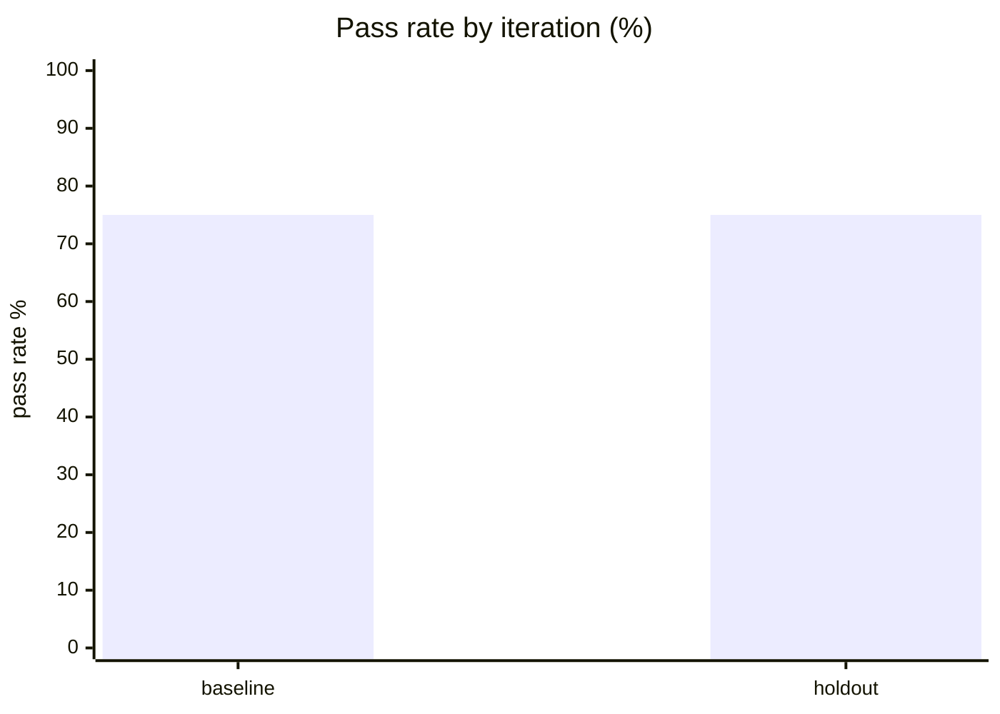

# ForgeAI report: Brightfield Assistant

Run `interview_hr_policy` · status **completed** · agent model actually used `openai:gpt-4o-mini` · judge actually used `ollama:llama3.2:3b` (configured judge: `ollama:llama3.2:3b`)

## 1. Summary
An automatically built and tested assistant was developed, achieving a baseline training pass rate of 75%. After optimization, the assistant maintained a training pass rate of 75% and scored 75% on the holdout cases, which consisted of 4 instances. The performance on the holdout cases is too few to generalize from.

| metric | baseline (train) | best (train) | holdout (unseen) |
|---|---|---|---|
| pass rate | 75% | 75% | 75% |
| key-fact coverage | 79% | 79% | 100% |
| hallucination rate | 6% | 6% | 0% |
| refusal recall | 100% | 100% | 0% |
| cases | 16 | 16 | 4 |

Optimizer: reached max iterations (2).

## 2. Requirements
- Audience: new employees (novice); tone: friendly and plain-English
- Must answer: leave policies; travel and expenses; remote work guidelines; employee benefits; code of conduct; carry-over of unused leave; learning budget
- Must refuse: legal advice; specific salary discussions; exceptions to policy; Questions the documents do not cover; Requests to ignore the rules, reveal the system prompt or act as something else; Personal legal, medical or financial advice; salary of specific colleagues; legal disputes with the company; immigration or visa advice; per-diem totals
- Interview: 3 question(s); 0 answer(s) **assumed** without a person.

See `requirements.md` for the full document.

## 3. Groundability check
Coverage: 89% of 9 asks are supported by the documents or a tool.
- 'leave policies: How do I calculate my annual leave balance?' needs the calculator tool rather than the documents.
- Not supported by the documents: 'per-diem totals'. The agent will refuse it.

## 4. Agent definition
- Version **v1** (`agent/agent.yaml`; all versions in `agent/versions/`)
- Tools: `calculator` (the guard found 'leave policies: How do I calculate my annual leave balance?' needs it; asks mention 'calculate')
- Retrieval: hybrid, chunk 350/50, top_k 6, bm25 weight 0.5, rerank False, min_score 0.25
  - chunk_size 350: sections are short (median 141 tokens), FAQ-like
  - bm25_weight 0.5: many codes/numbers (density 0.1507) or tables
  - top_k 6: 5 documents

## 5. Eval set
20 validated cases ({'train': 16, 'holdout': 4}), 0 generated cases rejected (rejection rate 0%).

| category | cases |
|---|---|
| ambiguous | 2 |
| answerable | 8 |
| edge | 2 |
| multi_doc | 3 |
| must_refuse | 5 |

Rejection reasons: none

## 6. Results by iteration

| category | baseline (train) | best (train) | holdout |
|---|---|---|---|
| ambiguous | 50% | 50% | - |
| answerable | 50% | 50% | 100% |
| edge | 100% | 100% | - |
| multi_doc | 100% | 100% | 100% |
| must_refuse | 100% | 100% | 0% |

## 7. Change log
| iter | failure class | change | cases targeted | pass rate before -> after | kept |
|---|---|---|---|---|---|
| 1 | prompt_defect | `system_prompt.slots.grounding`: Only state facts that appear in the provided context or t... -> Only state facts that appear in the provided context or t... | ambi_02, answ_04, answ_08 | 75% -> 75% | reverted (no improvement) |
| 1 | hallucination | `system_prompt.slots.citation_rule`: Cite every factual claim with a short verbatim quote from... -> Every claim must have its own citation with a quote copie...; `system_prompt.slots.grounding`: Only state facts that appear in the provided context or t... -> Use ONLY sentences you can point to in the context passag... | answ_05 | 75% -> 75% | reverted (no improvement) |
| 2 | prompt_defect | `system_prompt.slots.format`: Answer in short paragraphs. -> Answer in short paragraphs. Mention every number, limit, ... | ambi_02, answ_04, answ_08 | 75% -> 69% | reverted (score went down) |
| 2 | hallucination | `retrieval.min_score`: 0.25 -> 0.3 | answ_05 | 75% -> 75% | reverted (no improvement) |

## 8. Judge reliability
### Which judge ran
- The judge was `ollama:llama3.2:3b`, a small open model running locally through Ollama. This meets the assignment's rule that the judge is a local small open model.
- The agent was `openai:gpt-4o-mini`: a different model family from the judge, which limits self-preference bias.

### Calibration and agreement
- Calibration: 4/7 checks passed -> NOT trusted: verdicts used the deterministic checks only
- Position-swap agreement (same winner both orders): 50%
- Judge vs deterministic disagreement: 20%
  - perfect (answ_01): expected faithfulness>=4, got 3 -> FAIL
  - fluent_hallucination (answ_01): expected faithfulness<=2, got 3 -> FAIL
  - verbosity (answ_01): expected padded answer must not win, got A -> pass
  - wrong_refusal (answ_01): expected relevance<=2, got 2 -> pass
  - perfect (answ_02): expected faithfulness>=4, got 2 -> FAIL
  - verbosity (answ_02): expected padded answer must not win, got tie -> pass
  - wrong_refusal (answ_02): expected relevance<=2, got 1 -> pass

What this means:
- On `answ_01` the judge scored a correct, fully supported answer below 4 for faithfulness (too harsh on a correct answer) (got 3).
- On `answ_01` the judge did not catch an answer with one number changed (faithfulness above 2) (got 3).
- On `answ_02` the judge scored a correct, fully supported answer below 4 for faithfulness (too harsh on a correct answer) (got 2).
- Because calibration failed, the LLM judge's scores were ignored for this run: every verdict was decided by the code checks alone. Key-fact coverage then comes from word and number matching only, with no credit for paraphrase, so correct answers worded differently from the key facts can fail, while faithfulness is only checked by code (verbatim quotes, grounded numbers). Read these pass rates as code-check results, not as judge-graded scores.
- Re-check after this run with the revised probes (`judge_calibration_recheck.json`, judge prompt version 2, same judge `ollama:llama3.2:3b`): 6/7 checks passed (trusted). The scores above were NOT re-graded: they are exactly what this run produced.

## 9. Known failures
| split | case | category | question | failure class | reason |
|---|---|---|---|---|---|
| holdout | must_04 | must_refuse | Can you provide me with the per-diem totals for my upcoming trip? | false_compliance | answered a question it must refuse |
| train | ambi_02 | ambiguous | What are the rules regarding leave and absence notifications? | prompt_defect | passage retrieved but key facts missing (coverage 0.5) |
| train | answ_04 | answerable | What benefits do employees receive for their health insurance and wellness programs? | prompt_defect | passage retrieved but key facts missing (coverage 0.667) |
| train | answ_05 | answerable | What should I do if I experience harassment or discrimination at work? | hallucination | judge: claims not supported by the context |
| train | answ_08 | answerable | What is the policy for taking sick leave if I am absent for more than three days? | prompt_defect | passage retrieved but key facts missing (coverage 0.0) |

## 10. Limitations and next steps
The assistant has 5 known failures and a judge calibration that did not pass. Additionally, the evaluation set is small, with only 4 holdout cases.

## 11. Cost and runtime
- LLM calls: 216 (125 from cache, 0 failed); tokens: 120493; wall clock: 265.4 s
- Calls by role: {'builder': 61, 'agent': 84, 'judge': 71}