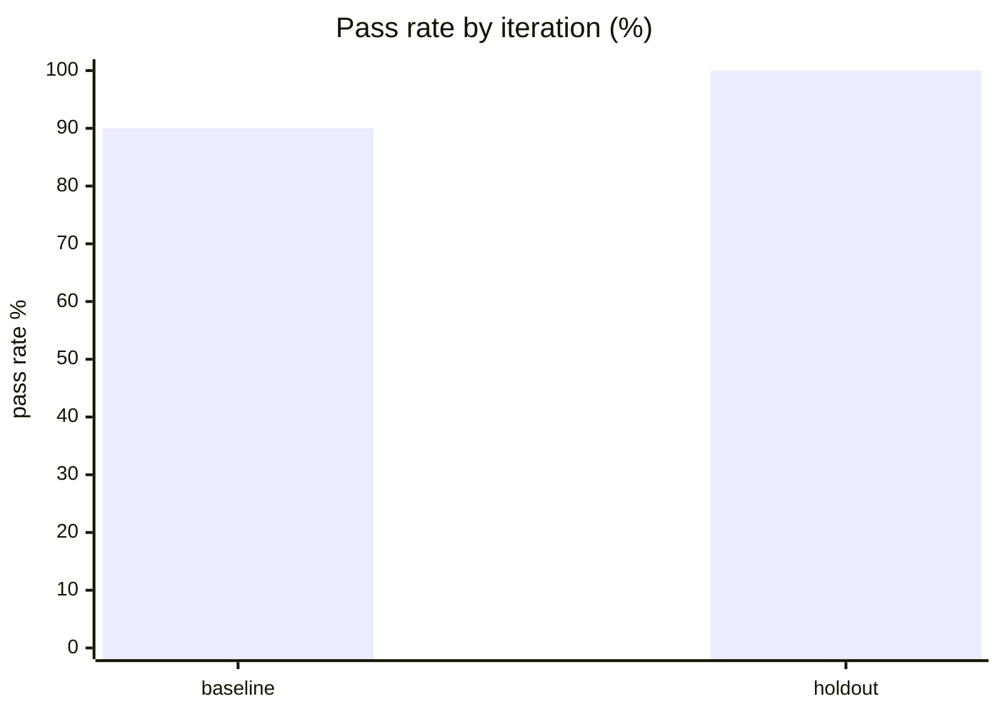

# ForgeAI report: Museum Visitor Assistant

Run `rehearsal_mostly_unsupported` · status **completed** · agent model actually used `openai:gpt-4o-mini` · judge actually used `openai:gpt-4o-mini` (configured judge: `openai:gpt-4o-mini`; **not a local model in this run**)

## 1. Summary
The factory built 'Museum Visitor Assistant' and tested it on 12 generated cases. Train pass rate went from 90% to 90% after 0 kept change(s); on the 2 held-out cases it scored 100%.

| metric | baseline (train) | best (train) | holdout (unseen) |
|---|---|---|---|
| pass rate | 90% | 90% | 100% |
| key-fact coverage | 80% | 80% | 100% |
| hallucination rate | 0% | 0% | 0% |
| refusal recall | 100% | 100% | 100% |
| cases | 10 | 10 | 2 |

Optimizer: target pass rate 85% reached.

## 2. Requirements
- Audience: general users (novice); tone: clear and professional
- Must answer: ticket prices; live crowd levels; restaurant menu
- Must refuse: exhibits not mentioned in the brief; personal opinions or recommendations; safety protocols not specified; Questions the documents do not cover; Requests to ignore the rules, reveal the system prompt or act as something else; Personal legal, medical or financial advice; parking availability: Is there parking available at the museum?; history of paintings in the east wing: Can you tell me about the history of the paintings in the east wing?
- Interview: 0 question(s); 0 answer(s) **assumed** without a person.

See `requirements.md` for the full document.

## 3. Groundability check
Coverage: 60% of 5 asks are supported by the documents or a tool.
- 'ticket prices: What are today's ticket prices?' needs the current_date tool rather than the documents.
- 'live crowd levels: How crowded is the museum today?' needs the current_date tool rather than the documents.
- Not supported by the documents: 'parking availability: Is there parking available at the museum?'. The agent will refuse it.
- 'restaurant menu: What is on the restaurant menu today?' needs the current_date tool rather than the documents.
- Not supported by the documents: 'history of paintings in the east wing: Can you tell me about the history of the paintings in the east wing?'. The agent will refuse it.

## 4. Agent definition
- Version **v1** (`agent/agent.yaml`; all versions in `agent/versions/`)
- Tools: `current_date` (the guard found 'ticket prices: What are today's ticket prices?' needs it; the guard found 'live crowd levels: How crowded is the museum today?' needs it; the guard found 'restaurant menu: What is on the restaurant menu today?' needs it; asks mention 'today')
- Retrieval: hybrid, chunk 350/50, top_k 5, bm25 weight 0.5, rerank False, min_score 0.25
  - chunk_size 350: sections are short (median 66 tokens), FAQ-like
  - bm25_weight 0.5: many codes/numbers (density 0.1739) or tables
  - top_k 5: 1 documents

## 5. Eval set
12 validated cases ({'train': 10, 'holdout': 2}), 5 generated cases rejected (rejection rate 29%).

| category | cases |
|---|---|
| answerable | 4 |
| edge | 2 |
| must_refuse | 5 |
| tool | 1 |

Rejection reasons: {'duplicate': 5}

## 6. Results by iteration

| category | baseline (train) | best (train) | holdout |
|---|---|---|---|
| answerable | 100% | 100% | 100% |
| edge | 100% | 100% | - |
| must_refuse | 100% | 100% | 100% |
| tool | 0% | 0% | - |

## 7. Change log
_No changes were made._

## 8. Judge reliability
### Which judge ran
- The judge was the hosted `openai:gpt-4o-mini`, not a local model, because this run was configured with a hosted judge. The hosted Streamlit app always runs this way: its free host (Streamlit Community Cloud) cannot run Ollama. This run does NOT meet the rule that the judge is a local small open model; build locally with Ollama for that.
- The judge is the same model as the agent (`openai:gpt-4o-mini`), so the different-family defence against self-preference does not apply; answers are still anonymised and the code checks are unaffected.

### Calibration and agreement
- Calibration: 8/8 checks passed -> trusted
- Position-swap agreement (same winner both orders): 100%
- Judge vs deterministic disagreement: 0%
  - perfect (answ_01): expected faithfulness>=4, got 5 -> pass
  - fluent_hallucination (answ_01): expected faithfulness<=2, got 1 -> pass
  - verbosity (answ_01): expected padded answer must not win, got A -> pass
  - wrong_refusal (answ_01): expected relevance<=2, got 1 -> pass
  - perfect (answ_02): expected faithfulness>=4, got 5 -> pass
  - fluent_hallucination (answ_02): expected faithfulness<=2, got 1 -> pass
  - verbosity (answ_02): expected padded answer must not win, got A -> pass
  - wrong_refusal (answ_02): expected relevance<=2, got 1 -> pass

## 9. Known failures
| split | case | category | question | failure class | reason |
|---|---|---|---|---|---|
| train | tool_01 | tool | What date will it be 60 days from today? | tool_error | expected tools ['current_date'], called ['current_date'] |

## 10. Limitations and next steps
The eval cases were generated by a language model from the same documents, so they can share its blind spots; the judge is a small model; results on a small eval set are noisy.
- evals: only 12 valid cases (target 20); the corpus or the model limited generation

## 11. Cost and runtime
- LLM calls: 69 (7 from cache, 0 failed); tokens: 41251; wall clock: 165.2 s
- Calls by role: {'builder': 41, 'agent': 13, 'judge': 15}