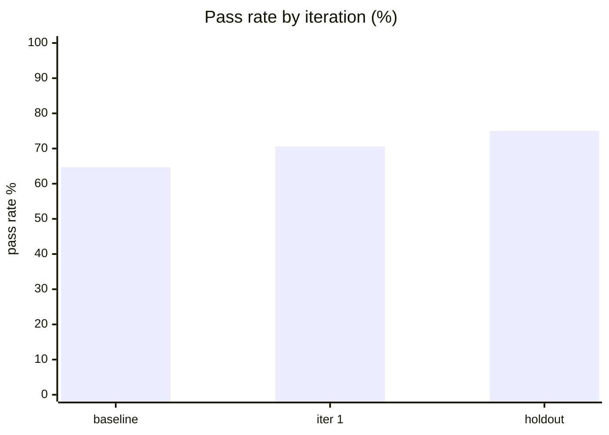

# ForgeAI report: Aurelia Support Assistant

Run `rehearsal_product_manual` · status **completed** · agent model actually used `openai:gpt-4o-mini` · judge actually used `openai:gpt-4o-mini` (configured judge: `openai:gpt-4o-mini`; **not a local model in this run**)

## 1. Summary
An automatically built and tested assistant was developed, achieving a baseline training pass rate of 65% and improving to a best training pass rate of 71% after optimization. The assistant performed well on the held-out cases, achieving a pass rate of 75%. Overall, the system demonstrated effective learning and adaptation capabilities during the testing phases.

| metric | baseline (train) | best (train) | holdout (unseen) |
|---|---|---|---|
| pass rate | 65% | 71% | 75% |
| key-fact coverage | 92% | 92% | 100% |
| hallucination rate | 29% | 18% | 25% |
| refusal recall | 100% | 100% | 100% |
| cases | 17 | 17 | 4 |

Optimizer: reached max iterations (2).

## 2. Requirements
- Audience: general users (novice); tone: clear and professional
- Must answer: setup of the Aurelia AX-200; daily cleaning procedures; descaling instructions; troubleshooting error codes; when to seek authorized service
- Must refuse: electrical repair instructions; comments on other brands; Questions the documents do not cover; Requests to ignore the rules, reveal the system prompt or act as something else; Personal legal, medical or financial advice
- Interview: 0 question(s); 0 answer(s) **assumed** without a person.

See `requirements.md` for the full document.

## 3. Groundability check
Coverage: 100% of 5 asks are supported by the documents or a tool.
- No warnings: every ask was supported.

## 4. Agent definition
- Version **v2** (`agent/agent.yaml`; all versions in `agent/versions/`)
- Tools: none
- Retrieval: hybrid, chunk 350/50, top_k 5, bm25 weight 0.5, rerank False, min_score 0.25
  - chunk_size 350: sections are short (median 138 tokens), FAQ-like
  - bm25_weight 0.5: many codes/numbers (density 0.0629) or tables
  - top_k 5: 1 documents

## 5. Eval set
21 validated cases ({'train': 17, 'holdout': 4}), 1 generated cases rejected (rejection rate 4%).

| category | cases |
|---|---|
| ambiguous | 2 |
| answerable | 12 |
| edge | 2 |
| must_refuse | 5 |

Rejection reasons: {'duplicate': 1}

## 6. Results by iteration

| category | baseline (train) | best (train) | holdout |
|---|---|---|---|
| ambiguous | 0% | 0% | - |
| answerable | 67% | 78% | 67% |
| edge | 50% | 50% | - |
| must_refuse | 100% | 100% | 100% |

## 7. Change log
| iter | failure class | change | cases targeted | pass rate before -> after | kept |
|---|---|---|---|---|---|
| 1 | hallucination | `system_prompt.slots.citation_rule`: Cite every factual claim with a short verbatim quote from... -> Every claim must have its own citation with a quote copie...; `system_prompt.slots.grounding`: Only state facts that appear in the provided context or t... -> Use ONLY sentences you can point to in the context passag... | ambi_01, answ_02, answ_03, answ_08, edge_01 | 65% -> 71% | kept |
| 2 | hallucination | `retrieval.min_score`: 0.25 -> 0.3 | answ_02, answ_03, edge_01 | 71% -> 71% | reverted (no improvement) |
| 2 | prompt_defect | `system_prompt.slots.grounding`: Use ONLY sentences you can point to in the context passag... -> Use ONLY sentences you can point to in the context passag... | ambi_01, ambi_02 | 71% -> 65% | reverted (score went down) |

## 8. Judge reliability
### Which judge ran
- The judge was the hosted `openai:gpt-4o-mini`, not a local model, because this run was configured with a hosted judge. The hosted Streamlit app always runs this way: its free host (Streamlit Community Cloud) cannot run Ollama. This run does NOT meet the rule that the judge is a local small open model; build locally with Ollama for that.
- The judge is the same model as the agent (`openai:gpt-4o-mini`), so the different-family defence against self-preference does not apply; answers are still anonymised and the code checks are unaffected.

### Calibration and agreement
- Calibration: 7/7 checks passed -> trusted
- Position-swap agreement (same winner both orders): 100%
- Judge vs deterministic disagreement: 0%
  - perfect (answ_01): expected faithfulness>=4, got 5 -> pass
  - verbosity (answ_01): expected padded answer must not win, got A -> pass
  - wrong_refusal (answ_01): expected relevance<=2, got 1 -> pass
  - perfect (answ_02): expected faithfulness>=4, got 5 -> pass
  - fluent_hallucination (answ_02): expected faithfulness<=2, got 1 -> pass
  - verbosity (answ_02): expected padded answer must not win, got A -> pass
  - wrong_refusal (answ_02): expected relevance<=2, got 1 -> pass

## 9. Known failures
| split | case | category | question | failure class | reason |
|---|---|---|---|---|---|
| holdout | answ_04 | answerable | How do I prepare the machine for first use? | hallucination | numbers not in the context or tools: [200.0] |
| train | ambi_01 | ambiguous | What should I do if the machine is not working properly? | prompt_defect | passage retrieved but key facts missing (coverage 0.5) |
| train | ambi_02 | ambiguous | What should I do if the water tank is empty? | prompt_defect | passage retrieved but key facts missing (coverage 0.5) |
| train | answ_02 | answerable | What steps should I take to prepare the Aurelia AX-200 for its first use? | hallucination | numbers not in the context or tools: [1.0] |
| train | answ_03 | answerable | How often should I descale my machine if I use hard water? | hallucination | cited a quote that is not in the passage |
| train | edge_01 | edge | how otfen shoudl i descale my machine if i use hard water | hallucination | cited a quote that is not in the passage |

## 10. Limitations and next steps
The assistant has six known failures, indicating areas where it did not perform as expected. Additionally, the evaluation set was small, consisting of only four holdout cases, which may limit the generalizability of the results.

## 11. Cost and runtime
- LLM calls: 159 (39 from cache, 0 failed); tokens: 127809; wall clock: 262.3 s
- Calls by role: {'builder': 44, 'agent': 72, 'judge': 43}