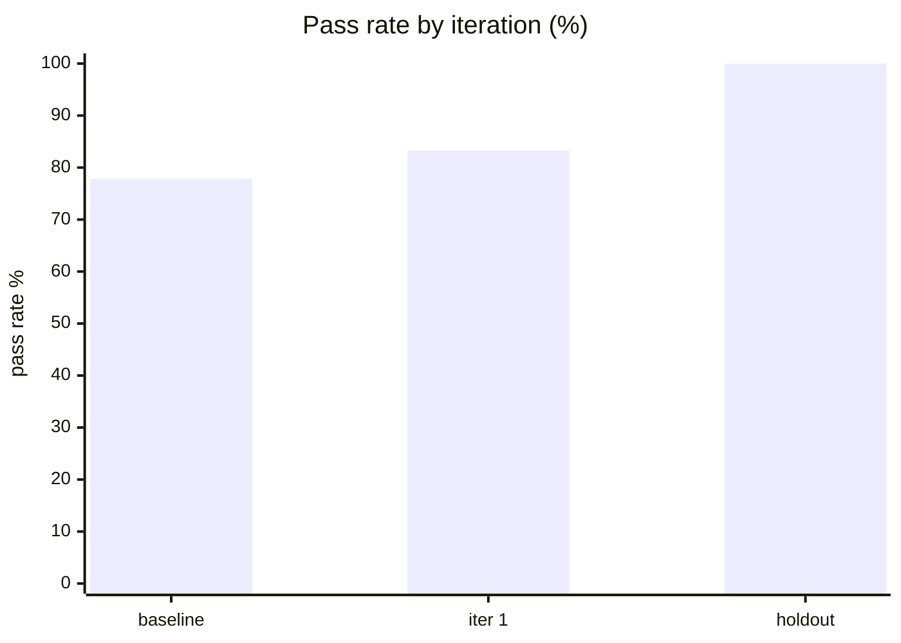

# ForgeAI report: Cargo Fleet Assistant

Run `20261126-222721-2768cb-ship_spares` · status **running** · agent model `openai:gpt-4o-mini` · judge `openai:gpt-4o-mini`

## 1. Summary
An automatically built and tested assistant was developed, achieving a baseline training pass rate of 78% and improving to a best training pass rate of 83% after optimization. The assistant performed exceptionally well on the held-out cases, achieving a 100% pass rate. Overall, the assistant demonstrated effective learning and adaptation capabilities during the testing phases.

| metric | baseline (train) | best (train) | holdout (unseen) |
|---|---|---|---|
| pass rate | 78% | 83% | 100% |
| key-fact coverage | 90% | 90% | 100% |
| hallucination rate | 6% | 6% | 0% |
| refusal recall | 100% | 100% | 100% |
| cases | 18 | 18 | 3 |

Optimizer: reached max iterations (2).

## 2. Requirements
- Audience: chief engineer of a cargo fleet (intermediate); tone: clear and professional
- Must answer: Equipment association; Inventory quantities; Supplier lead times; Order cost estimation; Delivery times; Weather forecast
- Must refuse: Purchase approvals; Safety-critical repair instructions; Quoting prices or terms not in documents; Questions the documents do not cover; Requests to ignore the rules, reveal the system prompt or act as something else; Personal legal, medical or financial advice; Finding spare parts: What is the part number for the fuel pump?; Compare minimum orders; Compare warranty terms
- Interview: 0 question(s); 0 answer(s) **assumed** without a person.

See `requirements.md` for the full document.

## 3. Groundability check
Coverage: 75% of 12 asks are supported by the documents or a tool.
- Not supported by the documents: 'Finding spare parts: What is the part number for the fuel pump?'. The agent will refuse it.
- 'Equipment association: Which equipment does part number 12345 belong to?' needs the csv_lookup tool rather than the documents.
- 'Inventory quantities: How many spare parts are on board for the ballast pump?' needs the csv_lookup tool rather than the documents.
- 'Order cost estimation: Can you estimate the total cost for ordering 5 units of part number 67890?' needs the calculator tool rather than the documents.
- 'Delivery times: How many days will it take for the delivery to arrive at the main port?' needs the calculator tool rather than the documents.
- 'Weather forecast: What is the weather forecast for the delivery port next week?' needs the http_weather tool rather than the documents.
- 'Flag parts below minimum stock' needs the csv_lookup tool rather than the documents.
- 'Compare supplier lead times' needs the calculator tool rather than the documents.
- Not supported by the documents: 'Compare minimum orders'. The agent will refuse it.
- Not supported by the documents: 'Compare warranty terms'. The agent will refuse it.
- 'Check if an offer is still valid' needs the current_date tool rather than the documents.

## 4. Agent definition
- Version **v2** (`agent/agent.yaml`; all versions in `agent/versions/`)
- Tools: `csv_lookup` (the corpus has 2 table(s): spares_inventory, suppliers; the guard found 'Equipment association: Which equipment does part number 12345 belong to?' needs it; the guard found 'Inventory quantities: How many spare parts are on board for the ballast pump?' needs it; the guard found 'Flag parts below min), `calculator` (the guard found 'Order cost estimation: Can you estimate the total cost for ordering 5 units of part number 67890?' needs it; the guard found 'Delivery times: How many days will it take for the delivery to arrive at the main port?' needs it; the guard found 'Compare supplier lead times' needs it; as), `current_date` (the guard found 'Check if an offer is still valid' needs it; asks mention 'still valid'), `http_weather` (the guard found 'Weather forecast: What is the weather forecast for the delivery port next week?' needs it; asks mention 'weather')
- Retrieval: hybrid, chunk 350/50, top_k 6, bm25 weight 0.5, rerank False, min_score 0.25
  - chunk_size 350: sections are short (median 139 tokens), FAQ-like
  - bm25_weight 0.5: many codes/numbers (density 0.0898) or tables
  - top_k 6: 4 documents

## 5. Eval set
21 validated cases ({'train': 18, 'holdout': 3}), 5 generated cases rejected (rejection rate 19%).

| category | cases |
|---|---|
| ambiguous | 2 |
| answerable | 9 |
| edge | 2 |
| multi_doc | 2 |
| must_refuse | 4 |
| tool | 2 |

Rejection reasons: {'duplicate': 5}

## 6. Results by iteration

| category | baseline (train) | best (train) | holdout |
|---|---|---|---|
| ambiguous | 50% | 50% | - |
| answerable | 86% | 86% | 100% |
| edge | 100% | 100% | - |
| multi_doc | 0% | 50% | - |
| must_refuse | 100% | 100% | 100% |
| tool | 100% | 100% | - |

## 7. Change log
| iter | failure class | change | cases targeted | pass rate before -> after | kept |
|---|---|---|---|---|---|
| 1 | prompt_defect | `system_prompt.slots.grounding`: Only state facts that appear in the provided context or t... -> Only state facts that appear in the provided context or t... | ambi_01, answ_07, mult_01 | 78% -> 78% | reverted (no improvement) |
| 1 | hallucination | `system_prompt.slots.citation_rule`: Cite every factual claim with a short verbatim quote from... -> Every claim must have its own citation with a quote copie...; `system_prompt.slots.grounding`: Only state facts that appear in the provided context or t... -> Use ONLY sentences you can point to in the context passag... | mult_03 | 78% -> 83% | kept |
| 2 | prompt_defect | `system_prompt.slots.format`: Answer in short paragraphs. -> Answer in short paragraphs. Mention every number, limit, ... | ambi_01, answ_07 | 83% -> 83% | reverted (no improvement) |
| 2 | hallucination | `retrieval.min_score`: 0.25 -> 0.3 | mult_03 | 83% -> 83% | reverted (no improvement) |

## 8. Judge reliability
- Calibration: 6/7 checks passed -> trusted
- Position-swap agreement (same winner both orders): 100%
- Judge vs deterministic disagreement: 8%
  - perfect (answ_01): expected faithfulness>=4, got 5 -> pass
  - fluent_hallucination (answ_01): expected faithfulness<=2, got 4 -> FAIL
  - verbosity (answ_01): expected padded answer must not win, got A -> pass
  - wrong_refusal (answ_01): expected relevance<=2, got 1 -> pass
  - perfect (answ_02): expected faithfulness>=4, got 5 -> pass
  - verbosity (answ_02): expected padded answer must not win, got A -> pass
  - wrong_refusal (answ_02): expected relevance<=2, got 1 -> pass

## 9. Known failures
| split | case | category | question | failure class | reason |
|---|---|---|---|---|---|
| train | ambi_01 | ambiguous | What are the lead times for spare parts delivery? | prompt_defect | passage retrieved but key facts missing (coverage 0.5) |
| train | answ_07 | answerable | What is the lead time for fuel injection parts and how is the minimum order quantity defined? | prompt_defect | passage retrieved but key facts missing (coverage 0.667) |
| train | mult_03 | multi_doc | What are the lead times for fuel injection parts from both S01 and S04, and how do they compare? | hallucination | cited a quote that is not in the passage |

## 10. Limitations and next steps
The assistant has three known failures and faced unsupported asks in three instances. Additionally, the evaluation set was small, consisting of only 21 cases, which may limit the generalizability of the results.

## 11. Cost and runtime
- LLM calls: 258 (239 from cache, 0 failed); tokens: 35580; wall clock: 91.0 s
- Calls by role: {'builder': 71, 'agent': 103, 'judge': 84}